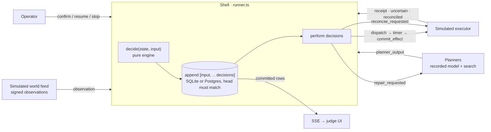

# KEEL architecture

## The loop: plan → execute → observe → re-evaluate

- **Pure engine** (`src/engine.ts`): `reduce(state, event)` folds the log; `decide(state, input)` returns decisions. No clock, no I/O, no randomness. Replay re-decides every recorded input and must reproduce every recorded decision exactly (tested for all scenarios and policies).
- **The clock drives only the simulated world** (feed delivery, step durations). The agent wakes only when an input arrives. A run with no events does no planning however long it runs (tested).
- **Event store** (`src/store.ts`): one append-only stream per run; `[input, …decisions]` commit in one transaction iff the stream head is unchanged (optimistic concurrency). Two adapters behind one async `Store` contract: SQLite (`node:sqlite`, `BEGIN IMMEDIATE`) and PostgreSQL (`pg`, row lock on the run head). The same 63-test suite runs on both.

## Persistence and process ownership
- **What is stored.** Per run: the event log, the stream head, simulated effects (insert-once by `opId`), visitor injections (with their signed envelope, in session order) and the session's world clock (monotonic upsert). Restart rebuilds everything from these rows; nothing lives only in memory.
- **One writer at a time.** On start a process claims the database: `owner.epoch += 1` and it keeps that number. Every write transaction re-reads the epoch under a lock (`BEGIN IMMEDIATE` on SQLite, `SELECT … FOR SHARE` on Postgres) and aborts with `FencedError` if a newer process has claimed. A fenced process stops all its sessions, answers `503` on `/api/*` and on `/api/health`, and can no longer append, apply an effect, prune or restore. This makes a zero-downtime deploy overlap safe: the old instance cannot apply an effect the new one also applies. Tested in-process (`test/g8`, `test/g9`) and with two Docker containers on Postgres (`scripts/hosted-check.sh`, `docs/evidence/hosted-check.txt`).
- **Schema versioning.** `schema_meta.version` (currently 1). A database from the pre-versioned build is refused with a clear message instead of being half-migrated; Postgres migrations run under an advisory lock.
- **Per-run mailboxes.** Every input for a run is processed in order on one promise chain; an operator command is built inside the mailbox (so a confirmation adopts the value current at that moment), and visitor injections of a session are serialised so persisted order, simulated-truth order and delivery order agree.
- **Eviction.** Only 40 sessions stay in memory. Evicting one closes it (it accepts no new work), waits for its in-flight clock tick, injection queue and mailboxes to settle, then drops its caches. A request that still held it gets `409`, and the next request reloads it from the store.
- **Live view.** SSE frames are built in commit order; each connection keeps a per-run cursor in its event id. If a frame cannot be built, the connections are closed rather than skipping rows; the browser reconnects with `Last-Event-ID` and the catch-up backfills from the store.
- **Export / import.** `node scripts/db.ts export|import` moves the whole database as one JSON dump (Postgres reads it in one `REPEATABLE READ` snapshot). It is the migration path off an expiring free database and between SQLite and Postgres; import refuses a non-empty target and verifies counts.

## Plan model (`src/model.ts`, `src/scenarios.ts`)

| Concept | Representation |
|---|---|
| Fact | `kind:entity.attribute` → value, with source, event id, time, rank |
| Assumption | `{fact, op, value \| ref}`, three-valued: unstable, missing or non-numeric ordering operands are **UNKNOWN**, which never satisfies a guard |
| Action contract (code) | `requires` (start assumptions), `maintains` (obligations after completion), `releases` (which obligations it ends), `produces`, `effectKey` (semantic effect identity), `commitment`, `duration`, `cost`, parameter domains |
| Goal | statement + checked predicates; persisted in the run's start context with a hash of the contract code |
| Plan | versioned ordered steps; revisions keep completed steps and their ids |

Planners never supply assumptions: the runtime derives them from the contracts.

## Evidence (`src/world.ts`)
Registered source → valid HMAC → permitted `kind:*.attribute` → timestamp within the simulation clock window → known fact of the right type → dedupe (accepted ids only, so a forgery cannot reserve a genuine id; a reused id with other content is rejected) → per-source sequence → **rank** (a lower-ranked source cannot overwrite a higher-ranked one). ≥3 value changes of one fact in 30 ticks marks it **UNSTABLE**; only an operator confirmation clears that.

## Change detection and impact
1. An accepted change is material only if a remaining step, a live commitment or the goal reads that fact (otherwise it is logged as "no impact").
2. The remaining plan is projected forward from beliefs: each step's assumptions in order, live obligations, no irreversible step while an obligation is broken, goal at the end.
3. A failure is a **contradiction** with its exact condition. Affected steps = failing steps + steps bound to the entity whose observed fact broke + causal downstream consumers. Completed steps and untouched pending steps are preserved.
4. An affected operation still in its preparation window is **fenced** (cancelled before its effect). An operation already applying is reconciled, never "cancelled".

## Repair
- Candidates: recorded model proposals (exact planning-context hash) and a deterministic **flaw-directed search** — resolve the first broken assumption by rebinding (propagated to sibling steps on the same entity), establishing (insert a step whose effect makes it true), releasing (insert a step that ends a broken commitment) or dropping; breadth-first by number of moves, so the first solved layer is the smallest change. Bounded full replan only if that fails.
- **Validator** (every candidate, every origin): shape, catalog, parameters bind to known entities, no completed effect repeated, one effect per plan, unaffected pending steps kept (unless an explicit full-replan scope), assumptions and commitments in order, goal reached.
- Ranking: edit distance (Levenshtein over step signatures), then cost.
- **Safe commit**: if the world revision or plan version moved since the request, the candidate is stale and re-planned (3 in a row ⇒ pause). Then the oscillation guard (returning to an abandoned plan with no progress ⇒ pause) and the revision budget (3 ⇒ pause) apply. Then the revision record is committed.

## Execution and recovery
`dispatch(opId, gen)` → `effect_ready(opId, gen)` → final check → `commit_effect(opId, gen, expect)` → executor applies once per opId (bound to a request hash) → `receipt(applied)` / `effect_uncertain` → `reconciled(found, applied)`. Wrong-generation messages are ignored. Receipts carry the applied mutation, which replay consumes. On restart: prepared ops are fenced and re-prepared under a new generation; committing/uncertain ops are reconciled; a pending repair is re-requested. Irreversible + unknown outcome ⇒ pause for an operator.

## Stability
Adverse changes act immediately (no debounce). A valid plan is never replaced by a "better" one. Flapping facts are UNKNOWN. Containment pauses (`unstable`, `oscillation`, `budget`, `ambiguous`, `stale`) latch until an operator resumes; only `no_repair` waits for new evidence. A commitment the agent learns was broken while live is recorded permanently as a violation, and the agent will not report the goal as met. Revision and planning budgets live in the log, so a restart does not refill them.

## Causal record ("I changed my mind because…")
Every revision stores: the sentence; trigger observation (source, old and new value, world time); all contributing observations; the broken assumption or commitment; affected / preserved / completed steps; removed / added steps; edit {inserted, removed, modified, distance}; every validator check; the chosen candidate (origin, scope, rationale, model provenance); every rejected candidate with its failed check; before and after plans.

## Baselines
Shared by every lane: simulated physics, the byte-identical signed event stream (tested), authentication, idempotency. Deliberately different: re-validation and repair.
- **Static / open loop**: follows the original plan, never re-checks.
- **Naive adaptive**: same engine; replans on any change, cheapest plan first, no stability rules.
- **Guarded static** (tests only): checks assumptions, cannot repair — stops safely and misses the goal.
Undisturbed control runs: every policy succeeds with zero revisions (tested). Metrics come only from the event log and the simulator's effect table.

## Why not LangGraph or Temporal
LangGraph checkpoints graph state, but its interrupts re-run the node on resume and it offers no assumption tracking or effect idempotency — we would still write the ledger, contracts and commit guard. Temporal's durable history and validated updates are the right pattern (borrowed here: append-only history, single writer, deterministic replay) but need a server. A free single-instance demo is better served by ~2.7k lines of TypeScript on Node's built-in SQLite, with Postgres as the hosted store.

## Files
`src/model.ts` contracts, conditions, projection, impact · `src/world.ts` evidence · `src/engine.ts` pure engine · `src/repair.ts` search + validator · `src/planner.ts` candidate sources · `src/store.ts` event store (SQLite + Postgres, fencing) · `src/sim.ts` simulated executor/truth · `src/runner.ts` shell + clock · `src/metrics.ts` · `src/server.ts` API + SSE · `ui/` judge UI.
